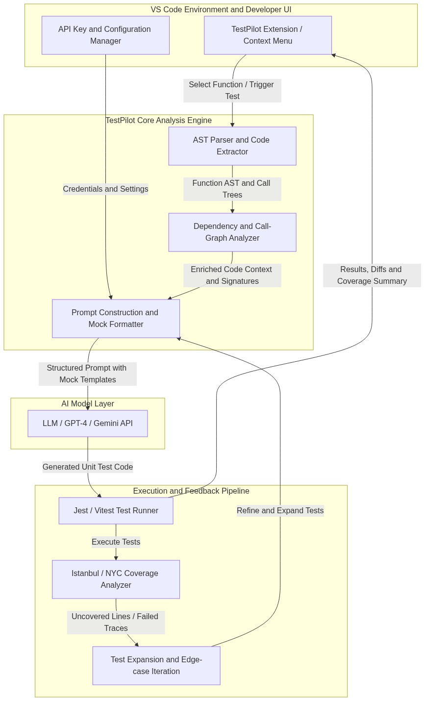

# 🚀 TestPilot AI
### Automated Unit Test Generation and Coverage Analysis Engine

[](https://opensource.org/licenses/ISC)
[](https://nodejs.org/)
[](https://jestjs.io/)
[](https://ai.google.dev/)

**TestPilot** is an intelligent automated unit testing tool designed for JavaScript and TypeScript codebases. It combines **Abstract Syntax Tree (AST)** static program analysis with modern **Large Language Models (Google Gemini & OpenAI GPT-4)** to synthesize production-ready Jest test suites, construct dependency mocks, execute tests in sandboxed environments, and iteratively improve code coverage.

---

## 🏛️ System Architecture



TestPilot operates across four cohesive architectural tiers:
1. **Static Program Analysis (AST Engine)**: Traverses codebases via `@babel/parser` and TypeScript compiler APIs to extract function signatures, parameters, control-flow branches, and intra-module call trees.
2. **AI Prompt Orchestration Core**: Translates AST code context into structured prompts enforcing happy paths, boundary conditions, edge cases (`null`/`undefined`, type coercion, async rejections), and mock templates.
3. **Execution & Sandboxing Engine**: Spawns isolated Jest/Vitest runners to execute generated test suites and parse runtime error traces.
4. **Coverage & Iterative Feedback Loop**: Collects statement, line, and branch coverage metrics (via Istanbul/NYC) and re-prompts the AI for uncovered code paths (`--expand-unit-tests`).

---

## ⚡ Quickstart Guide

### 1. Prerequisites
- **Node.js**: v18+ recommended
- **Test Framework**: Jest

### 2. Installation
```bash
npm install
```

### 3. Configure AI API Key
TestPilot natively supports Google Gemini (Free Tier) and OpenAI:

```bash
# Using Google Gemini API (Recommended & Free):
node -e "const fs = require('fs'); if (!fs.existsSync('./.pythagora')) fs.mkdirSync('./.pythagora'); fs.writeFileSync('./.pythagora/config.json', JSON.stringify({ gemini_api_key: 'YOUR_GEMINI_KEY', model: 'gemini-2.5-flash' }, null, 2));"

# Or using OpenAI API:
npx pythagora --config --openai-api-key <YOUR_OPENAI_API_KEY>
```

---

## 💻 Usage & CLI Commands

### Generate Unit Tests

* **For a single function:**
  ```bash
  node src/scripts/unit.js --func <FUNCTION_NAME> --path ./src/utils/common.js
  ```

* **For all exported functions in a file:**
  ```bash
  node src/scripts/unit.js --path ./src/utils/common.js
  ```

* **For an entire codebase:**
  ```bash
  node src/scripts/unit.js --path ./src
  ```

### Run Generated Tests & View Code Coverage
```bash
# Run all tests with Istanbul coverage report:
npm test

# Run a specific test suite:
npx jest ./pythagora_tests/unit/src/utils/common/
```

### Expand Existing Tests for Higher Coverage
```bash
node src/scripts/unitExpand.js --path ./pythagora_tests/unit/src/utils/
```

---

## 📁 Project Structure

```text
├── src/
│   ├── helpers/         # AI integration, AST parsing, and Jest execution helpers
│   │   ├── geminiApi.js # Gemini 2.5 Flash test synthesis engine
│   │   ├── api.js       # Unified API routing and client configuration
│   │   └── unitTests.js # Unit test orchestration pipeline
│   ├── scripts/         # Core CLI execution scripts (unit.js, unitExpand.js)
│   ├── utils/           # AST code traversal, path resolution, and argument parsers
│   └── templates/       # Jest scaffolding and mock templates
├── pythagora_tests/     # Auto-generated Jest unit tests and coverage reports
├── system_architecture.png # System architecture diagram
├── package.json
└── README.md
```

---

## 🎓 Academic Capstone Project
* **Course:** CSL 801 - Project Phase III
* **Institution:** Indian Institute of Information Technology Una (IIIT Una)
* **Supervisor:** Dr. Mrityunjay Singh
* **Team:**
  * Vansh Verma (23165): Backend & DevOps Lead
  * Vasu Goel (23166): AI / ML Lead
  * Aditya Kumar Goyal (23105): VS Code Extension & AI Test Analysis Lead
